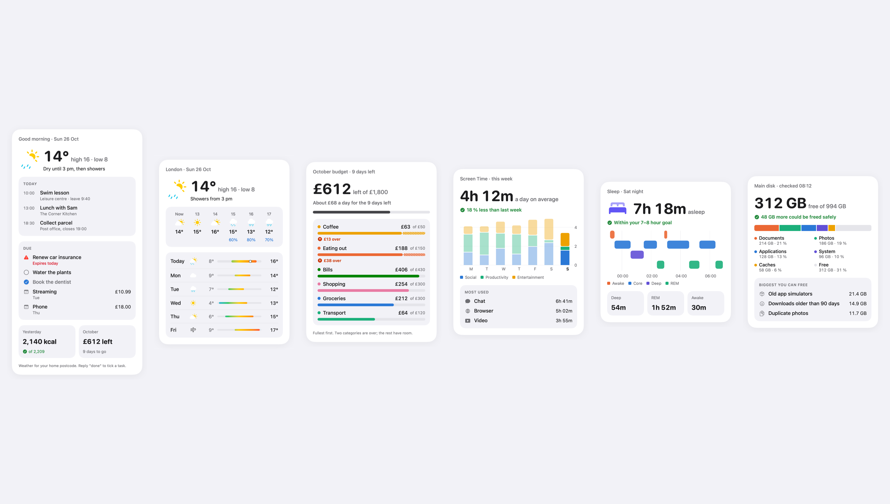
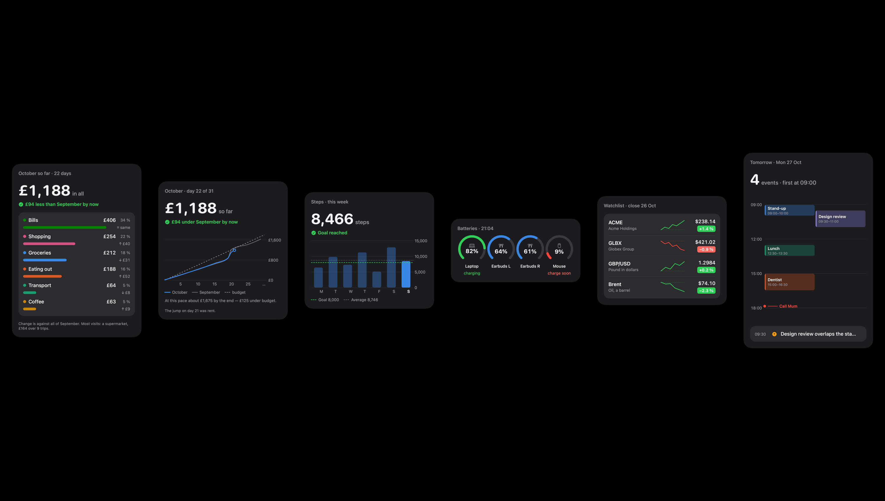

# CardKit

Reports as phone-width pictures, in one look: a morning brief, a budget, a week of steps, a disk, a night's sleep,
a league table. A card is JSON in and a PNG out, drawn headless with SwiftUI and Swift Charts — made to be sent
in a chat by an agent, so every number on it is worked out here, checked, and never wrong in a way nobody was told
about.




```swift
import CardKit

let card = try CardDecoder.card(from: json)                         // snake_case JSON, errors name the field
let picture = try CardRenderer.render(card, theme: .dark)           // @MainActor; 1,254 px wide PNG
try picture.png.write(to: url)
```

The [`card`](https://github.com/arraypress/swift-card-cli) command line tool wraps it: `card brief.json -o
brief.png`, `card example budget`, `card blocks bars`.

## A card

Every card is the same shape, in the same order:

| Part | What | Example |
|---|---|---|
| `eyebrow` | what · when | "October budget · 9 days left" |
| `hero` | the one number that answers the question, with its unit, a title, tags, an SF Symbol | "£612 left of £1,800" |
| `status` | where that leaves you, in words with an icon | ✓ "About £68 a day for the 9 days left" |
| `blocks` | one to eight visual forms | a list, bars over time, rings… |
| `footnote` | where the numbers came from | "From your message, not weighed." |

Without a `hero` or `status`, the first `limits`, `breakdown`, `bars` or `trend` block supplies one: what's left,
the total against last time, the latest bar against its goal or average, a running total against last month.

## Blocks

Twenty-seven forms, chosen from what the fleet's tools report (an inventory of every tool's output, 2026-10-26), plus achievements, tracking, maps, QR codes, before/after and a month:

| Block | For | Apple equivalent |
|---|---|---|
| `list` | an agenda, bills, a checklist (`done`) | Reminders, Calendar list |
| `tiles` | two to four small figures | widget grid |
| `breakdown` | a total split into parts, largest first, share and change | Screen Time categories |
| `limits` | parts against limits, fullest first; past the limit is striped | budgets, Screen Time limits |
| `bars` | a bar per period, latest strong; goal, target band, average; stacked with a legend | Health, Screen Time |
| `trend` | lines: a running total vs last time and a target pace; a smoothed measure | Health trends, Stocks |
| `range` | low–high per row on one scale; `temperature` colours it cool to warm | Weather's ten days |
| `hourly` | an hour, an icon, a value | Weather's hourly strip |
| `rings` | progress to goals, in a row or concentric | Activity |
| `gauges` | dials: battery, signal, speed | Batteries widget |
| `segmented` | one bar split into parts, the rest free | iPhone Storage |
| `timeline` | spans and moments: sleep stages (a row per stage), a video's events; `vertical` for a day | Health sleep, Calendar day |
| `heatmap` | a square per day, weeks as columns | Fitness streaks |
| `sparklines` | rows with a tiny line and the change | Stocks |
| `chips` | tags that wrap; dashed when only maybe | — |
| `comparison` | two choices, the pick outlined | — |
| `table` | columns of figures, your row picked out | Sports |
| `score` | a match as it stands | Sports |
| `text` | a paragraph, bullets, a quotation | — |
| `images` | local pictures in a grid | Photos |
| `award` | one achievement: a medal (gold, silver, bronze or the part's colour), what it took, a personal best's before → after | Fitness awards |
| `awards` | medals earned in colour, ones still to earn in grey with a progress ring | Fitness Awards |
| `tracker` | steps in order — done, now, next, failed: a parcel, a flight, an order | Wallet order tracking |
| `map` | Apple Maps with pins and a route (needs the network when drawn) | Maps |
| `qr` | a QR code to scan: Wi-Fi, a payment link, a ticket | Wallet passes |
| `pair` | two pictures side by side: before and after an edit | Photos edit |
| `month` | a month's calendar, days marked by colour, today ringed | Calendar month |

`CardExamples.all` holds a worked card for each kind of report (34, every block used); `card example <name>`
prints one.

## The look

- **Apple's terms throughout:** grouped-background surfaces (`#F2F2F7` page, white card; black and `#1C1C1E` in
  dark), label colours, SF Pro for words, SF Rounded for the numbers that matter, continuous corners, SF Symbols in
  their own colours, Swift Charts with recessive trailing axes. 390 pt wide on a 14 pt page, 1,254 px at 3×.
- **Status** is Apple's system green, orange and red for marks, and their high-contrast steps for words, always
  with an icon: never colour alone.
- **Parts** (categories, series) take the reference data-viz palette in slot order: blue, orange, aqua, yellow,
  magenta, green, violet, red. A part keeps its slot on every card (`slot`, else its position in the input), so
  coffee is the same colour on the budget, the breakdown and the logged spend. **Measured:** Apple's own hues
  cannot do this job. With green, orange and red kept for status, every 4-, 5- and 6-slot ordering of Apple's
  remaining colours (blue, purple, cyan, indigo, mint, teal, pink, yellow, brown — dark steps adjusted into band)
  fails the colour-blind separation check in light or dark; the reference palette passes in both.
- **Past a limit** a bar stays its part's colour and the excess is striped, with an icon and words — the
  categorical orange and the status orange are too close to tell apart otherwise.
- **Dark** is the same layout with the colours swapped (`theme: .dark`), for a dark chat.
- **Transparent around the card.** The 14 pt margin (room for the shadow) is transparent, so in a conversation the
  card sits on the chat's own background like a widget; `render(…, opaque: true)` fills it with the page colour
  (`#F2F2F7` / black) for documents and galleries.

## Money

Money is exact: `{"amount": "4.20", "currency": "GBP"}`, the shape `store` writes, decoded from the string (never
through a `Double`). It must be exact to the currency's smallest unit (two decimals for GBP, none for JPY, three
for BHD — ISO 4217), one currency per card, never added to plain numbers. A single amount shows its pence
(£4.20); totals are whole (£1,188). Numbers and money are written for the reader's locale.

## Text, files and words

- **Every card has a text version** — `CardText.text(card)`: the same numbers in reading order, for VoiceOver (as the
  picture's description), Messages search, a phone that won't load the image, and the record of what was sent. A
  QR code's contents are never put in it (they can be a Wi-Fi password).
- **Cards are private and short-lived** — `CardFiles.newCard()` gives a new file in
  `~/Library/Caches/arraypress/cards` (mode 0700) and removes cards older than a day: they show meals, money and
  health, so they don't go in /tmp and don't pile up after they're sent.
- **The kit's own words can be replaced** — a card's `wording` swaps any phrase the kit writes itself ("left of
  {total}", "{amount} over the limit", "of {total}"…) for another language or the owner's own words; `Words.english`
  lists all 46 and their placeholders, and a misspelt id or placeholder is refused rather than ignored.
- **Refunds** — a breakdown part may be negative: listed last, no bar, no share of what was spent, and taken off the
  net total.
- **Maps** — `CardRenderer.maps(for: card)` fetches them from Apple Maps first (MKMapSnapshotter works from a
  command line tool; measured about 3 s with the network) and draws the route and pins in the card's colours;
  `render(…, maps:)` draws what it's given, and a map it couldn't fetch says so on the card.

## Refused, not drawn wrong

`CardChecks.problem(card)` names the field: `blocks[0].rows[0].value: 4.205 has more decimals than GBP has`,
`amounts mix EUR and GBP: draw one card per currency`, `blocks[1].rows[3] has the same colour slot (2) as
blocks[1].rows[1]`, `hero.symbol: no SF Symbol named 'clould'`, `blocks[0].bars[2].parts: 2 parts but the legend
names 3`. `CardRenderer.render` throws `CardError.invalid` with it and draws nothing.

## Reference pictures

`Tests/CardKitTests/Golden/` holds every example drawn light at 1× (33, maps left out). The tests redraw them and
name any that changed by more than 0.5 % of their pixels — a warning, because a macOS update can move a glyph;
`CARDKIT_GOLDEN_STRICT=1` makes it a failure, and `CARDKIT_GOLDEN_UPDATE=1` redraws them after a deliberate change.

## Measured

- 1,254 px wide, about 0.1 s a card from the command line (`card`, 2026-10-26, M-series Mac).
- 46 tests: every rule of the arithmetic, the checks, the wording, the text version and the private files against
  hand-worked values; all 34 examples drawn in both themes; 33 reference pictures compared. Deliberate breaks of the
  rules: 31 of 32 (0.1) and 21 of 22 (0.2) made a test fail; the two that didn't are equivalent (a tie-break Swift's
  stable sort already makes, and a tracker rule the "current" state always overrides).

## Requirements

macOS 14 or later. MIT.
